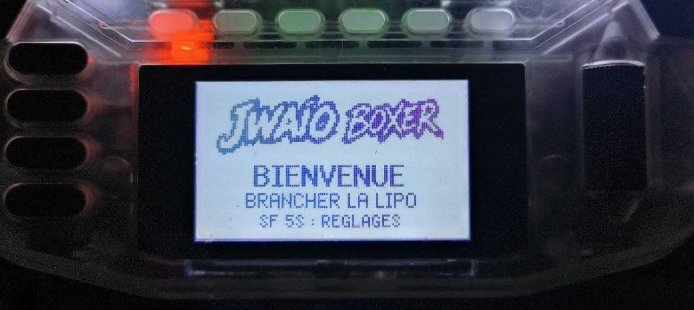

# JWAIO Boxer v0.2.1 Alpha [ FREESTYLE EDITION ]

**Script FPV dédié à la RadioMaster Boxer et à son écran monochrome 128 × 64 pixels.**

J'ai créé JWAIO Boxer pour retrouver l'esprit de JWAIO sur une radio qui ne peut pas utiliser le widget couleur des TX15 et TX16S. Cette interface **TOOLS** privilégie les informations essentielles au freestyle, sans affichage GPS.

## Télécharger

| Radio | EdgeTX | Version | Archive |
|---|---|---|---|
| RadioMaster Boxer | 2.12.2 | v0.2.1 Alpha | [Télécharger JWAIO Boxer](boxer/releases/JWAIO_BOXER_V0.2.1_Alpha.zip?raw=true) |

[Vérifier l'empreinte SHA-256](boxer/releases/SHA256SUMS.txt)

## État de la version

Le 31 octobre 2026, les essais sur RadioMaster Boxer ont confirmé :

- le bon fontionnement des toutes les interfaces ;
- l'absence de Freeze pendant les derniers essais réalisés sans connexion USB ;
- l'audibilité des seize sons fournis ;
- l'affichage de tout les réglages possible.

L'ensemble des fonctions en vol reste à valider. Cette version conserve donc le statut **Alpha**.

## Fonctions principales

- contrôle avant vol avec tension par cellule et liaison ELRS ;
- écran de vol avec batterie, chronomètre, LQ et mesures radio ;
- bilan après le désarmement ;
- QWAD Finder fondé sur l'évolution du signal et des bips ;
- alertes de batterie et de télémétrie ;
- annonces sonores configurables ;
- journal CSV sans GPS sur la carte SD ;
- réglages et compteurs sauvegardés par modèle.

Les indications ARM, Angle, BlackBox, Failsafe ou RTH correspondent aux commandes lues sur la radio. Elles ne modifient jamais les mixages et ne constituent pas des confirmations du contrôleur de vol.

## Installation et documentation

- **[Installer JWAIO Boxer pas à pas](boxer/docs/INSTALLATION.md)**
- [Comprendre les écrans et les fonctions](boxer/docs/FONCTIONS.md)
- [Consulter la compatibilité et l'état des essais](boxer/docs/VALIDATION.md)
- [Lire les notes de version](boxer/CHANGELOG.md)
- [Voir le contenu du paquet](boxer/releases/README.md)

L'installation consiste à copier les dossiers `LOGS`, `SCRIPTS` et `SOUNDS` à la racine de la carte SD après avoir choisi **USB Storage (SD)** sur la radio. Le guide illustré détaille chaque étape.

## Autres versions de JWAIO

Le widget couleur pour TX15/TX16S, la galerie de skins et JWAIO Cleaner restent disponibles sur la [branche principale du projet](https://github.com/DrJeckyllMrHyde/JWAIO-EdgeTX/tree/main).
