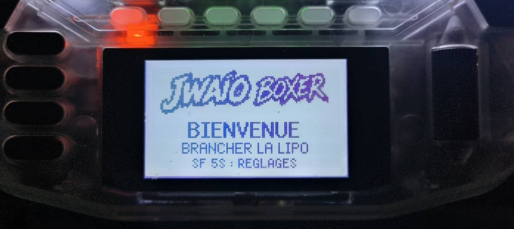

# JWAIO Boxer

> Ébauche de la section Boxer, publiée pour relecture avant son intégration à la branche principale.

JWAIO Boxer est une interface FPV conçue spécialement pour la **RadioMaster Boxer** et son écran monochrome de 128 × 64 pixels. Il reprend l'esprit de JWAIO dans un script **TOOLS** adapté aux limites et aux commandes de cette radio.

Il ne s'agit pas du widget couleur destiné aux TX15 et TX16S. L'installation, l'affichage et le numéro de version de JWAIO Boxer suivent leur propre cycle.

## Télécharger JWAIO Boxer

| Radio | Version | État | Téléchargement |
|---|---|---|---|
| RadioMaster Boxer | v0.2.1 Alpha | Testée sur radio, essais en vol à poursuivre | [Télécharger](releases/JWAIO_BOXER_V0.2.1_Alpha.zip?raw=true) |

Cette version cible **EdgeTX 2.12.2**. Le paquet contient six scripts Lua, seize sons et les documents de licence. [Vérifier l'empreinte SHA-256](releases/SHA256SUMS.txt).

Le 31 octobre 2026, les essais sur RadioMaster Boxer ont confirmé le démarrage du correctif, l'absence de gel et l'audibilité des sons lors des derniers essais réalisés sans connexion USB. L'ensemble des fonctions en vol reste à valider : cette version conserve donc le statut **Alpha**.

## Ce que le script affiche

- un écran d'accueil adapté à la Boxer ;
- un contrôle avant vol avec les informations essentielles ;
- un écran de vol lisible sur 128 × 64 pixels ;
- un bilan après le désarmement ;
- un écran Finder lié aux commandes configurées ;
- des alertes sonores et une alerte de batterie critique ;
- des réglages accessibles directement depuis le script.

Les indications ARM, Angle, BlackBox, Failsafe ou RTH décrivent les commandes lues sur la radio. Elles ne remplacent pas une télémétrie de confirmation du contrôleur de vol et ne modifient jamais les mixages du modèle.

## Aperçu des écrans

Les captures réelles sont présentées dans l'ordre d'utilisation :

1. accueil ;
2. avant vol ;
3. vol ;
4. bilan ;
5. Finder ;
6. réglages et alertes.

Chaque image possède une courte légende expliquant ce que le pilote voit et dans quelle situation l'écran apparaît. Retrouvez toutes les captures dans le guide [Écrans et fonctions](docs/FONCTIONS.md).

### Accueil

L'accueil confirme le lancement de JWAIO Boxer. Il invite à brancher la batterie LiPo et rappelle que le maintien de **SF pendant cinq secondes** ouvre les réglages.

## Installation

Consultez le [guide d'installation pour débutants](docs/INSTALLATION.md). La procédure finale sera vérifiée directement à partir du ZIP fourni.

## Documentation

- [Installation pour débutants](docs/INSTALLATION.md)
- [Écrans et fonctions](docs/FONCTIONS.md)
- [Compatibilité et validation](docs/VALIDATION.md)

## Projet JWAIO

JWAIO Boxer fait partie du projet JWAIO, aux côtés du widget couleur TX15/TX16S, de la galerie de skins et de JWAIO Cleaner. Chaque produit conserve néanmoins ses fichiers, sa documentation et ses versions.