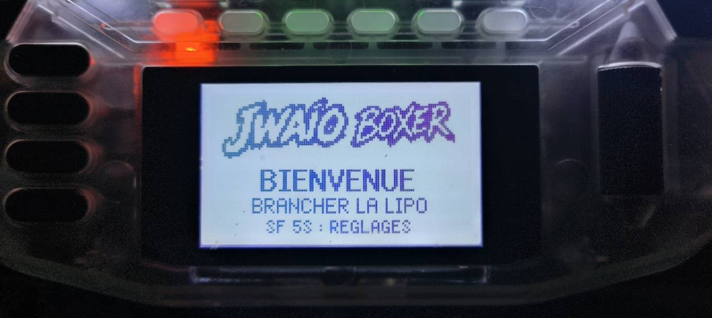
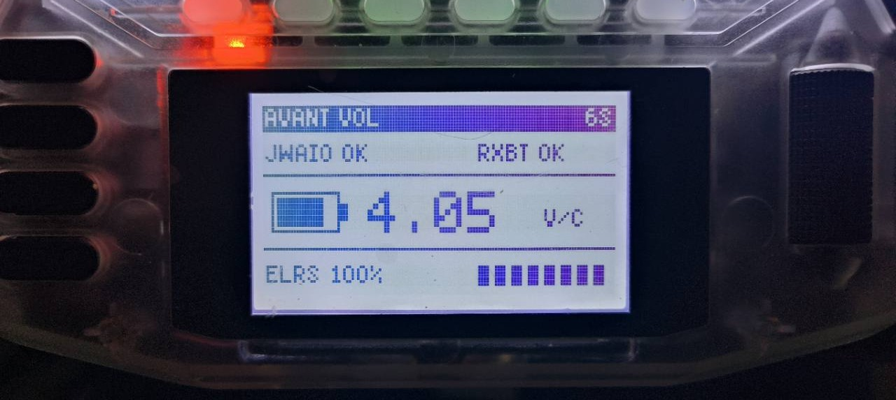
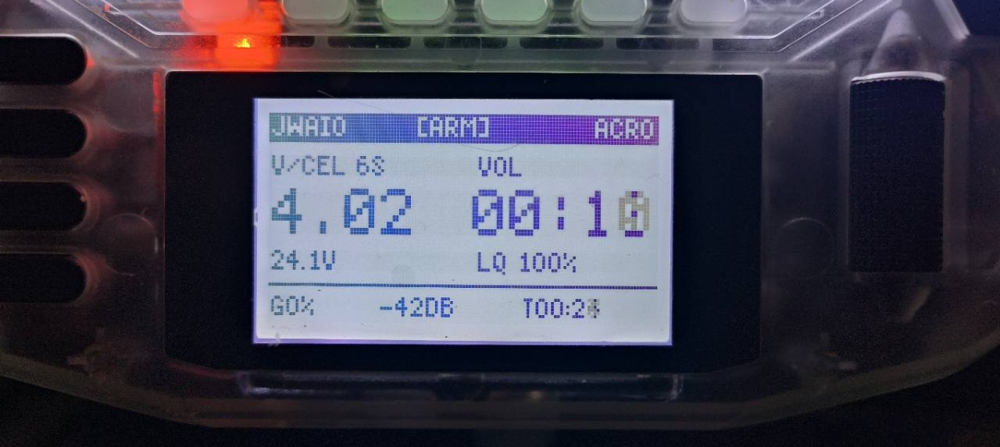
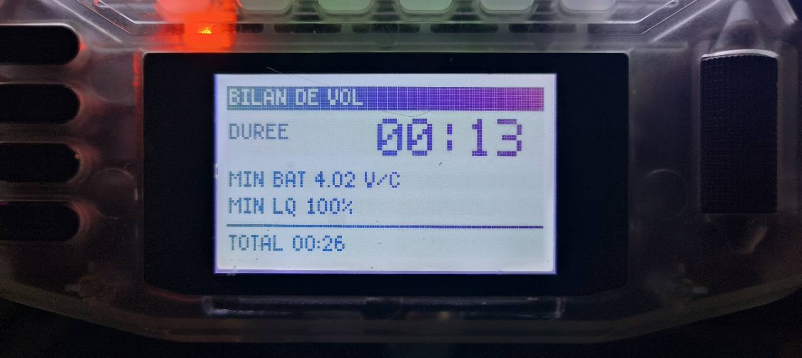
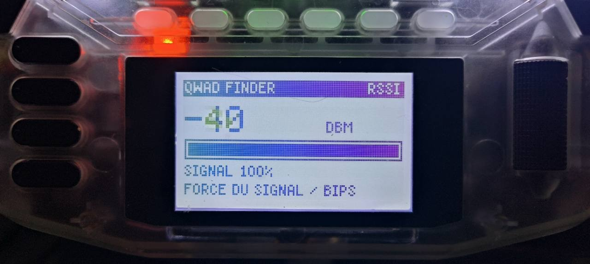
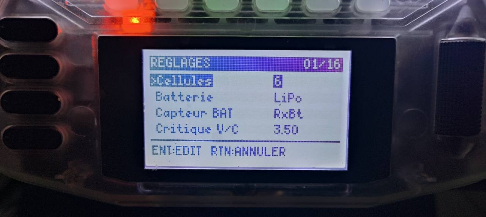
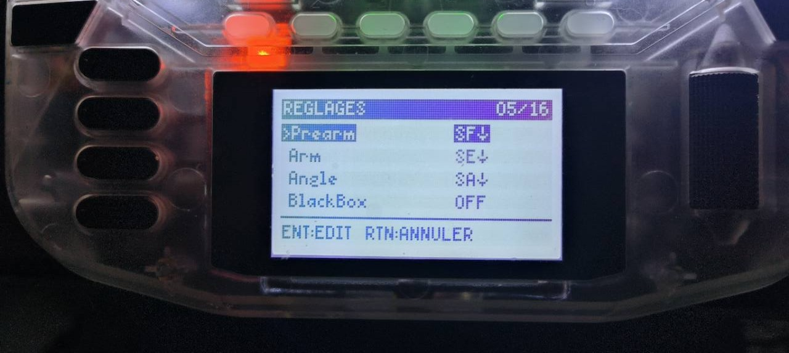
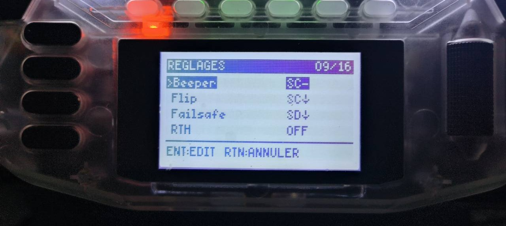
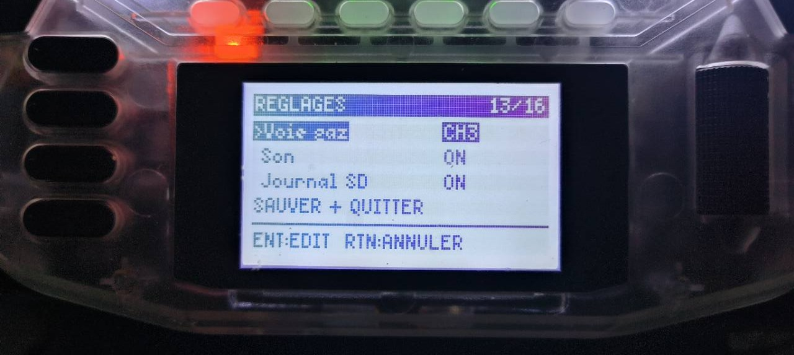

# Écrans et fonctions de JWAIO Boxer

> Les légendes définitives seront associées aux captures réelles fournies.

## Accueil

Présente JWAIO Boxer au lancement et confirme que les principaux modules du script ont été chargés. L'écran invite à brancher la batterie LiPo et rappelle que le maintien de **SF pendant cinq secondes** ouvre les réglages.

## Avant vol

Regroupe les informations utiles avant l'armement :

- **JWAIO OK** confirme que le script est chargé ;
- **RXBT OK** indique que le capteur de tension choisi fournit une valeur ;
- le nombre de cellules configuré apparaît dans le bandeau ;
- la grande valeur indique la tension par cellule ;
- **ELRS** et la jauge donnent l'état de la liaison radio disponible.

Sur cette capture d'exemple, une batterie 6S est détectée à **4,05 V par cellule** et la liaison ELRS affiche 100 %. Ces indications aident au contrôle avant vol, mais ne remplacent pas les vérifications habituelles du modèle.

## En vol

Affiche les informations essentielles dans les limites de l'écran monochrome 128 × 64 pixels :

- état JWAIO, commande ARM et mode de vol dans le bandeau ;
- tension par cellule et tension totale de la batterie ;
- chronomètre du vol en cours ;
- qualité de liaison LQ ;
- mesures radio disponibles et temps total mémorisé.

Le script privilégie la lisibilité et n'affiche pas les informations GPS inutiles au pilotage freestyle prévu. Les mentions **ARM** et **ACRO** correspondent aux commandes lues sur la radio, pas à une confirmation envoyée par le contrôleur de vol.

## Bilan

Après le désarmement, le bilan résume :

- la durée du dernier vol ;
- la tension minimale par cellule relevée pendant ce vol ;
- la valeur LQ minimale relevée ;
- le temps de vol total mémorisé.

La capture montre un vol de 13 secondes, une tension minimale de 4,02 V par cellule et un LQ minimal de 100 %. Le bilan reste disponible jusqu'au prochain événement prévu par le script, par exemple un nouvel armement ou l'ouverture du Finder.

## Finder

Le QWAD Finder réagit aux commandes configurées et exploite la mesure radio disponible. Il affiche notamment :

- la valeur RSSI en dBm lorsqu'elle est disponible ;
- une jauge et un pourcentage indicatif de signal ;
- une aide sonore dont le rythme dépend de la force du signal.

La capture montre un RSSI de −40 dBm et un signal indiqué à 100 %. Cette fonction aide à rechercher le modèle à proximité en observant l'évolution du signal et des bips. Elle ne fournit **ni direction ni distance** jusqu'au quad.

## Batterie critique

Signale une tension par cellule inférieure au seuil configuré. Cette alerte complète les protections du modèle et du contrôleur de vol ; elle ne les remplace pas.

## Réglages

Permettent d'adapter les sources, interrupteurs, seuils et sons. Les captures montreront uniquement les options utiles à l'utilisateur, avec un exemple simple pour débuter.

Le bandeau supérieur indique la page actuelle parmi les seize pages disponibles. Utilisez la navigation de la radio pour sélectionner une ligne, puis **ENT** pour la modifier. **RTN** annule ou revient à l'écran précédent.

### Batterie et seuil critique

Cette page permet de choisir :

- le nombre de cellules de la batterie ;
- le type de batterie ;
- le capteur utilisé pour la tension ;
- le seuil critique exprimé en volts par cellule.

La capture montre un exemple en **6S LiPo**, avec le capteur `RxBt` et un seuil critique de **3,50 V par cellule**. Ces valeurs restent un exemple : elles doivent correspondre au modèle et à sa télémétrie.

### Commandes de vol

Cette page associe les positions d'interrupteurs aux commandes **ARM**, **Angle** et **BlackBox**.

La page suivante configure **Beeper**, **Flip**, **Failsafe** et **RTH**. Une fonction réglée sur `OFF` n'est pas surveillée par JWAIO Boxer.

Ces choix permettent au script de lire les commandes de la radio et d'afficher l'interface correspondante. Ils ne modifient pas les mixages et ne prouvent pas que le contrôleur de vol a exécuté la commande.

### Son, journal SD et sauvegarde

Cette page permet d'activer ou de couper les annonces sonores et l'enregistrement du journal sur la carte SD. La ligne **SAUVER + QUITTER** enregistre les changements avant de fermer les réglages.