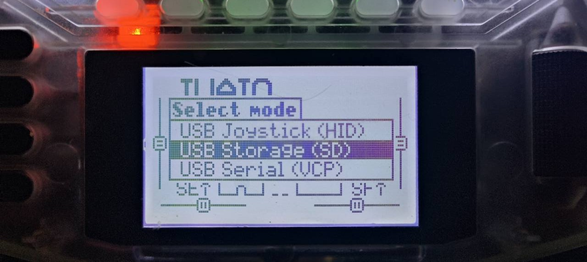
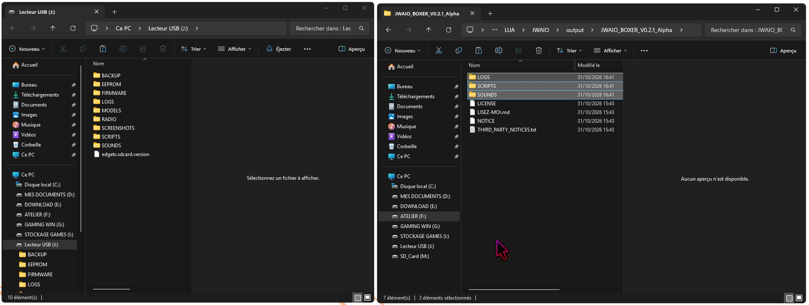
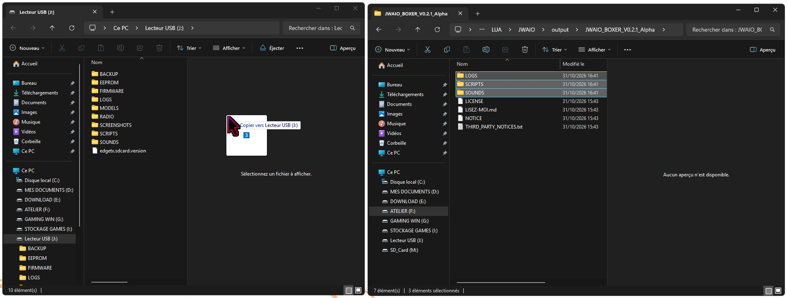
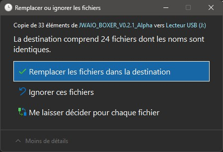

# Installer JWAIO Boxer

> Guide officiel de JWAIO Boxer v0.2.1 Alpha pour EdgeTX 2.12.2.

## Avant de commencer

Vous aurez besoin :

- d'une RadioMaster Boxer compatible ;
- d'**EdgeTX 2.12.2** ;
- d'un câble USB ou d'un lecteur de carte SD ;
- d'une sauvegarde récente de la carte SD de la radio.

## Installation

1. Éteignez la radio et sauvegardez le contenu de sa carte SD.
2. Téléchargez `JWAIO_BOXER_V0.2.1_Alpha.zip` depuis la section Boxer.
3. Décompressez le ZIP sur votre ordinateur.
4. Allumez la Boxer, puis branchez-la à l'ordinateur avec le câble USB.
5. Dans le menu **Select mode** affiché sur la radio, choisissez **USB Storage (SD)** et validez avec **ENT**.
6. Sur l'ordinateur, ouvrez le nouveau lecteur correspondant à la carte SD de la radio.
7. Dans le dossier décompressé, sélectionnez uniquement les trois dossiers `LOGS`, `SCRIPTS` et `SOUNDS`.
8. Copiez ces trois dossiers à la racine du lecteur de la radio, à côté des dossiers qui portent déjà ces noms.
9. Si Windows signale que certains fichiers existent déjà, choisissez **Remplacer les fichiers dans la destination**. Cette action met à jour les fichiers JWAIO Boxer et les sons communs contenus dans le paquet.
10. Éjectez proprement le lecteur USB.
11. Débranchez le câble, puis redémarrez la radio.
12. Ouvrez **SYS**, puis **TOOLS**, et lancez **JWAIO Boxer**.

Les fichiers `LICENSE`, `NOTICE`, `THIRD_PARTY_NOTICES.txt` et `LISEZ-MOI.md` sont des documents à consulter sur l'ordinateur. Il n'est pas nécessaire de les copier sur la carte SD.

Si un ancien fichier `/SCRIPTS/TOOLS/jwbox.luac` est présent, supprimez uniquement ce fichier compilé avant de redémarrer. Conservez `jwbox.lua`, le dossier `/SCRIPTS/JWBOX/CFG/` et les autres fichiers de la carte SD : le dossier `CFG` contient les réglages et les compteurs propres à chaque modèle.

### 1. Choisir le stockage USB de la carte SD

Après avoir branché la radio allumée, sélectionnez **USB Storage (SD)** et appuyez sur **ENT**. Ce choix permet à l'ordinateur d'accéder aux fichiers de la carte SD.

N'utilisez pas **USB Joystick (HID)** ni **USB Serial (VCP)** pour cette installation : ces modes ne font pas apparaître la carte SD comme un lecteur.

### 2. Préparer les deux fenêtres

Ouvrez la racine du lecteur USB de la Boxer dans une première fenêtre. Dans une seconde fenêtre, ouvrez le dossier JWAIO Boxer décompressé et sélectionnez `LOGS`, `SCRIPTS` et `SOUNDS`.

### 3. Copier les dossiers vers la radio

Faites glisser les trois dossiers sélectionnés vers la racine du lecteur USB de la Boxer. Ne les placez pas à l'intérieur d'un autre dossier.

### 4. Remplacer les fichiers de la version précédente

Si cette fenêtre apparaît, cliquez sur **Remplacer les fichiers dans la destination**. La sauvegarde réalisée avant l'installation vous permettra de revenir en arrière en cas de besoin.

## Première ouverture

À la première ouverture, vérifiez que l'écran d'accueil apparaît sans erreur. Gardez ensuite le script ouvert pendant son utilisation : il ne peut pas suivre le vol après sa fermeture.

Débranchez le câble USB avant les essais. Les derniers tests sans USB se sont déroulés sans gel et avec tous les sons audibles ; des silences et des gels avaient été associés à certains essais réalisés pendant une connexion USB.

Avant tout essai avec un modèle, effectuez les premiers contrôles sur table, hélices retirées. Vérifiez les interrupteurs, les annonces sonores et les réglages sans modifier les mixages de sécurité de votre modèle.

## En cas de problème

Photographiez l'écran complet et notez :

- la version de JWAIO Boxer ;
- la version d'EdgeTX ;
- l'étape qui provoque l'erreur ;
- le texte exact affiché ;
- les fichiers déjà présents dans les dossiers JWAIO Boxer.

La procédure de désinstallation sera ajoutée après inspection du paquet final.