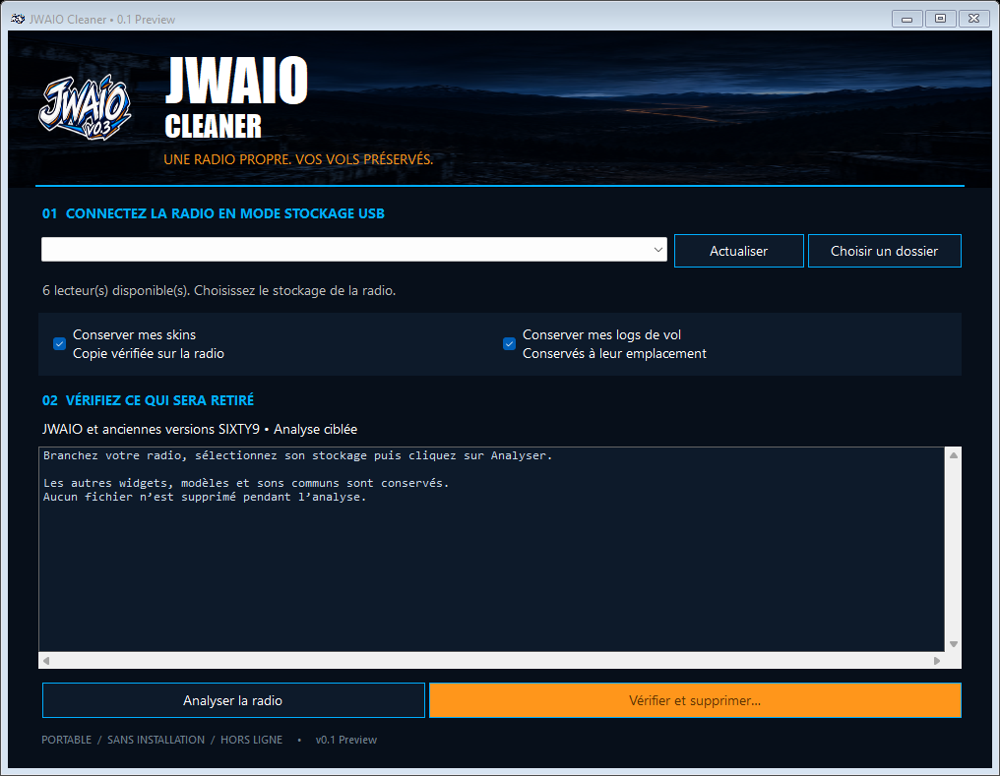

# JWAIO Cleaner — Windows 10 / 11

Version 0.2 Preview, Windows 10/11 uniquement. Linux est reporté.

**Le nouvel EXE 0.2 possède une nouvelle empreinte.** Son rapport antivirus est en cours de relecture et le rapport 0.1 ne s'applique pas à ce fichier. Aucune garantie d'innocuité n'est revendiquée.

Le paquet de test 0.2 est disponible dans [`releases/cleaner-v0.2-preview`](../releases/cleaner-v0.2-preview/). Vérifiez son empreinte SHA-256 avant utilisation et commencez sur une copie de votre carte SD.

[Code source](../tools/JWAIO-Cleaner/) · [Retour à JWAIO](../README.md)

## Utilisation

1. Lancez **JWAIO-Cleaner.exe**, depuis le Bureau ou une clé USB.
2. Branchez la radio avec son port USB de données et choisissez **Stockage USB** sur la radio.
3. Sélectionnez le lecteur de la radio. Cleaner reconnaît JWAIO TX15/TX16, SIXTY9 et JWAIO Boxer. Si nécessaire, utilisez **Actualiser** ou **Choisir un dossier**.
4. Choisissez si vous souhaitez conserver vos **skins**, vos **logs de vol** et les **réglages Boxer** du dossier `SCRIPTS/JWBOX/CFG`. Les trois cases sont cochées par défaut.
5. Cliquez sur **Analyser la radio**, puis vérifiez la liste complète.
6. Cliquez sur **Vérifier et supprimer…**, puis confirmez le lecteur et vos choix. La confirmation sélectionne « Non » par défaut.
7. Attendez le bilan, retirez JWAIO / SIXTY9 des écrans des modèles concernés dans EdgeTX, puis éjectez le stockage avant de débrancher.

La suppression est définitive, sans passage par la Corbeille. Aucune suppression n’a lieu pendant l’analyse.

## Skins et logs

Les skins conservés sont copiés dans `JWAIO-Sauvegardes/<date-identifiant>/`, **sur la radio**. Leur arborescence d’origine est conservée et chaque copie est vérifiée par SHA-256 avant de supprimer les originaux. Le widget et ses sons sont ensuite retirés. Pour les anciennes versions sans dossier `skins`, le dossier `img` et le fichier `config.lua` sont sauvegardés pour préserver les éléments visuels personnalisés.

Pour réutiliser un skin, réinstallez la version souhaitée du widget, puis recopiez votre dossier de skin depuis cette sauvegarde. Ne remplacez pas tout le `config.lua` d’une nouvelle version par une ancienne configuration.

Les logs conservés restent dans `LOGS/JWAIO` et `LOGS/SIXTY9`, à leur emplacement d’origine. Les sauvegardes antérieures créées par Cleaner sont exclues des analyses suivantes.

Pour Boxer, les logs conservés restent dans `LOGS/JWBOX`. Lorsque l'option correspondante est cochée, le dossier `SCRIPTS/JWBOX/CFG` est copié et vérifié dans `JWAIO-Sauvegardes` avant le nettoyage.

## Périmètre du nettoyage

- Dossiers `WIDGETS/JWAIO` et `WIDGETS/SIXTY9`, y compris les fichiers compilés présents dans ces dossiers.
- Copies renommées commençant par `JWAIO-`, `JWAIO_`, `JWAIO.` ou `JWAIO ` (et équivalents SIXTY9), seulement si `main.lua` contient le chemin interne du widget connu.
- Dossiers de sons propres au widget sous `SOUNDS/<langue>/JWAIO` et `SOUNDS/<langue>/SIXTY9`.
- Dossiers de logs propres au widget, uniquement si la conservation est décochée.
- Notices `JWAIO_README.txt` et `SIXTY9_README.txt` à la racine concernée.
- Paquets décompressés à un niveau sous la racine, dont le nom appartient à la famille JWAIO / SIXTY9 et qui contiennent WIDGETS.
- Pour JWAIO Boxer uniquement : `SCRIPTS/TOOLS/jwbox.lua`, `SCRIPTS/JWBOX`, `SOUNDS/<langue>/JWBOX` et, si leur conservation est décochée, `LOGS/JWBOX`.

Les modèles EdgeTX, les autres widgets, les sons communs et les logs généraux restent intacts. Les réglages des écrans dans les modèles ne sont pas modifiés : retirer l’instance du widget se fait depuis la radio. Les archives ZIP, dossiers arbitrairement renommés, chemins personnalisés hors de ce périmètre et copies plus profondément imbriquées ne sont pas recherchés. Les fichiers partagés comme les licences générales ne sont pas supprimés.

## Portabilité

Un seul EXE contient l’application, le logo et le fond. Aucun installateur, service, téléchargement, paramètre persistant, cache applicatif, journal local ni accès au registre n’est programmé. Aucun droit administrateur n’est demandé. L’application utilise le .NET Framework fourni avec Windows 10/11 ; aucune dépendance ne doit être ajoutée sur un Windows standard.

Les seules écritures normales sont les sauvegardes demandées et les suppressions confirmées sur le stockage sélectionné. L’application ne s’extrait pas dans un dossier temporaire. Les éventuelles traces gérées par Windows lui-même ne sont pas sous le contrôle de Cleaner. Le code source, ce guide et l’aperçu ne sont pas nécessaires pour lancer l’EXE.

## Vérifications et limites

135 assertions automatisées ont passé : huit combinaisons de conservation, prise en charge de Boxer, préservation des autres scripts EdgeTX, sauvegardes vérifiées, détection de changements avant suppression, fichier en lecture seule, copies anciennes et refus d’une jonction vers un autre dossier.

11 copies d’archives réelles ont également été nettoyées avec vérification des sauvegardes : SIXTY9 0.1.0 à 0.1.6, JWAIO 0.3.0 alpha et les trois variantes JWAIO 0.3.1 (TX15, TX16 Mk1/Mk2, TX16 Mk3). Interface compilée, démarrée et contrôlée visuellement sur cette machine Windows.

Cette Preview 0.2 a été validée sur une copie réelle du paquet JWAIO Boxer v0.2.1 Alpha : 23 fichiers retirés et réglages `CFG` sauvegardés puis vérifiés. Elle n’a pas encore été validée sur toutes les configurations Windows 10/11 et radios prises en charge. L’exécutable n’est pas signé numériquement. Une déconnexion, une panne de stockage ou une erreur d’accès pendant la suppression peut laisser un nettoyage partiel : le bilan l’indique ; les suppressions déjà effectuées ne sont pas annulées. Ne débranchez pas la radio pendant l’opération.

## Sources

Le dossier [tools/JWAIO-Cleaner](../tools/JWAIO-Cleaner/) contient le code, les tests et les ressources graphiques d’origine. `build-windows.ps1` compile l’EXE avec le compilateur du .NET Framework Windows. Les visuels proviennent des créations JWAIO existantes et relèvent de la licence des ressources du dépôt.
